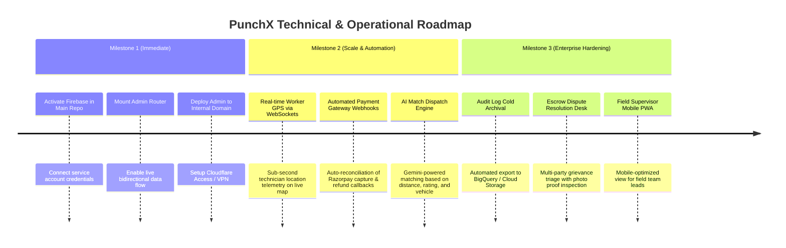

# PunchX Enterprise Platform: Executive Progress Report & Integration Roadmap

**Date**: October 14, 2026  
**Document Version**: 1.0.0  
**Target Repositories**:
- **Admin Command Center**: `c:\Users\my359\Desktop\Admin-dashboard-punchx` (Port 5173)
- **Main Consumer Platform**: `c:\Users\my359\Desktop\Punchx-full-info` (Port 3000)

---

## 1. What We Have Achieved (Current State)

We have engineered a **production-ready, enterprise-grade Admin Command Center** designed for multi-city on-demand field service operations (Kolkata Metropolitan, Nabadwip Circular, and Howrah Central), completely isolated in its own secure repository.

### Summary of Completed Modules & Systems

| System / Module | Key Capabilities Implemented | Verification State |
| :--- | :--- | :--- |
| **Dual-Repository Security Bridge** | Decoupled architecture with `x-admin-key` encrypted authentication; dynamic platform controls for convenience fee (₹29), surge surcharge (₹99), take-rate (15%), and maintenance switch; automatic 30s health probe with latency tracking; resilient local storage fallback. | Verified (`platform_bridge_test` recording, 0 build errors) |
| **Worker & Specialist Management** | 4 operational subtabs: (1) Directory & Roster with real-time duty switcher (`on_duty`, `on_job`, `off_duty`, `suspended`); (2) Live Dispatch & Attendance with 1-click field assignment modal; (3) Safety Gear & KYC compliance tracking (PPE, police clearance, Aadhaar); (4) Performance & IMPS payout disbursement modal. | Verified (`worker_management_demo` recording) |
| **Executive Overview & Cockpit** | Live platform GMV, completed bookings counter, geofence radius indicators (8km Kolkata & Nabadwip), triage notification bell with live counters, quick action shortcuts. | Verified |
| **User & Citizen Management** | Comprehensive citizen and provider directory, search & status filters, detailed profile drawer, reason-backed account suspension, and interactive KYC verification approval/rejection modal. | Verified |
| **Promotional Content & Banners** | Interactive mobile carousel preview, promotional banner scheduler, position placement (`hero_carousel`, `mid_feed`, `footer_spotlight`), and click-through analytics. | Verified |
| **Financial & Transaction Operations** | Real-time Razorpay transaction ledger, 1-click refund approval & customer communication modal, failed payment retry engine, and pro commission payout settlement. | Verified |
| **System Updates & Offers** | Multi-channel broadcast composer (All, Customers, Professionals) with estimated reach calculators, promotional coupon creator (fixed & percentage discounts with usage counters). | Verified |
| **Business Reports & Exports** | Date-range filters, city-wise GMV breakdown charts, category revenue distributions, 1-click CSV/Excel report exporter. | Verified |
| **Governance & Role-Based Access** | Granular permission matrix across 12 distinct system capabilities, instant admin persona switcher for testing, and immutable audit logs with admin identity and IP stamping. | Verified |

---

## 2. What We Have to Achieve in the Future (Roadmap)

To scale PunchX from regional staging to high-throughput commercial production, the following capabilities represent the planned roadmap:



### Key Upcoming Deliverables:
1. **Sub-Second Worker Telemetry (WebSockets / SSE)**:
   - Upgrade the current polling mechanism to WebSockets or Server-Sent Events for real-time tracking of technician coordinates as they travel to customer job sites.
2. **Automated Payment Gateway Webhooks**:
   - Ingest Razorpay/Stripe webhooks directly into the admin audit ledger to instantly flag chargebacks, fraudulent attempts, and auto-settle commissions.
3. **AI Dispatch & Matching Engine**:
   - Utilize Gemini 2.5 Flash to automatically recommend the optimal technician for emergency 15-minute bookings based on current proximity, historical SLA on-time rate, and equipment verification.
4. **Dispute Resolution & Customer Grievance Desk**:
   - Add a dedicated interface to inspect before/after service photos, customer complaints, and issue partial/full warranty payouts.

---

## 3. Manual Work You Need to Do (Step-by-Step Guide)

To link your live Firebase and backend database to the Admin Dashboard, here is the exact step-by-step checklist of what you need to configure:

### Step 1: Firebase Credentials in `Punchx-full-info`

The main repository already has the Firebase Firestore adapter built (`src/backend/db/firebaseAdapter.ts`), which automatically uses Firebase when credentials are provided.

#### How to get your Firebase Service Account:
1. Go to the [Firebase Console](https://console.firebase.google.com/).
2. Select your project (e.g. `gen-lang-client-0120647960` or your custom project).
3. Click the **Gear icon (Project Settings)** &rarr; **Service accounts** tab.
4. Click **Generate new private key**. A JSON file will download to your computer.

#### How to supply it to the backend (Choose Option A or Option B):
- **Option A (Recommended for Local Dev)**:
  - Rename the downloaded file to `firebase-service-account.json`.
  - Place it in `c:\Users\my359\Desktop\Punchx-full-info\`.
  - In `Punchx-full-info\.env`, add:
    ```env
    GOOGLE_APPLICATION_CREDENTIALS="./firebase-service-account.json"
    ```
- **Option B (Recommended for Production / Cloud)**:
  - Base64 encode the JSON file content.
  - In `Punchx-full-info\.env`, set:
    ```env
    FIREBASE_SERVICE_ACCOUNT="eyJ0eXBlIjogInNlcnZpY2VfYWNjb3VudCIs..."
    ```

> [!NOTE]
> Even if you do not add Firebase credentials immediately, the backend uses a built-in **in-memory database fallback** that allows you to test full end-to-end functionality without breaking!

---

### Step 2: Activating the Admin Bridge in `Punchx-full-info`

When you are ready to connect the main website server, perform these two simple file edits in `Punchx-full-info`:

#### 1. Add `src/backend/routes/adminBridgeRoutes.ts`
Create this file in `c:\Users\my359\Desktop\Punchx-full-info\src\backend\routes\adminBridgeRoutes.ts` (you can also copy it directly from the Admin Panel's **Platform Bridge Modal &rarr; Backend Integration Code** tab):
```typescript
import { Router, Request, Response, NextFunction } from 'express';
import { dbAdapter } from '../db/index.js';
import { logger } from '../logger.js';

export const adminRouter = Router();

export const requireAdminApiKey = (req: Request, res: Response, next: NextFunction) => {
  const adminKey = (req.headers['x-admin-key'] as string) || req.headers['authorization']?.replace('Bearer ', '');
  const expectedKey = process.env.ADMIN_API_KEY || 'punchx_admin_secure_live_key_2026_9941a8';
  if (!adminKey || adminKey !== expectedKey) {
    return res.status(401).json({ success: false, error: 'Unauthorized: Invalid admin key' });
  }
  next();
};

adminRouter.use(requireAdminApiKey);

adminRouter.get('/health', async (_req, res) => {
  res.json({ success: true, status: 'connected', platform: 'PunchX Core Backend', dbProvider: dbAdapter.providerName, timestamp: new Date().toISOString() });
});
adminRouter.get('/users', async (req, res) => res.json({ success: true, users: await dbAdapter.listUsers(req.query.role as string) }));
adminRouter.patch('/users/:uid', async (req, res) => res.json({ success: true, user: await dbAdapter.upsertUser({ ...req.body, uid: req.params.uid }) }));
adminRouter.get('/workers', async (_req, res) => res.json({ success: true, applications: await dbAdapter.listWorkerApplications() }));
adminRouter.post('/workers', async (req, res) => res.status(201).json({ success: true, application: await dbAdapter.createWorkerApplication(req.body) }));
adminRouter.patch('/workers/:id', async (req, res) => res.json({ success: true, application: await dbAdapter.updateWorkerApplicationStatus(req.params.id, req.body.status) }));
adminRouter.get('/orders', async (req, res) => res.json({ success: true, orders: await dbAdapter.listOrders(req.query as any) }));
adminRouter.patch('/orders/:id/status', async (req, res) => res.json({ success: true, order: await dbAdapter.updateOrderStatus(req.params.id, req.body.status) }));
```

#### 2. Mount in `Punchx-full-info/server.ts`
Import `adminRouter` and mount it before the general consumer rate limiter:
```typescript
import { adminRouter } from './src/backend/routes/adminBridgeRoutes.js';

// Inside startServer(), mount admin routes:
app.use('/api/admin', adminRouter);
```

#### 3. Update `Punchx-full-info/.env`
Ensure your admin secret key matches:
```env
ADMIN_API_KEY=punchx_admin_secure_live_key_2026_9941a8
PORT=3000
```

---

### Step 3: Production Deployment Verification

When moving from local development to production hosting:
1. Deploy `Punchx-full-info` to your backend host (e.g., Render, Railway, AWS, or Google Cloud Run).
2. Deploy `Admin-dashboard-punchx` to an internal hosting platform (e.g., Vercel, Cloudflare Pages) behind authentication.
3. Update `VITE_MAIN_API_URL` in `Admin-dashboard-punchx/.env` to point to your live backend domain (e.g. `https://api.punchxapp.co.in`).
4. Ensure the `ALLOWED_ORIGINS` array in `Punchx-full-info/server.ts` includes your production admin dashboard domain (e.g. `https://admin.punchxapp.co.in`).

---

### Checklist Summary for You

- [ ] **Download Firebase Service Account JSON** from Firebase Console and place in `Punchx-full-info`.
- [ ] **Verify `ADMIN_API_KEY`** in both repositories' `.env` files.
- [ ] **Start both servers** (`npm run dev` in both folders).
- [ ] **Open Admin Dashboard** at `http://localhost:5173` and click **Sync with Main Platform Now** in the top header.
